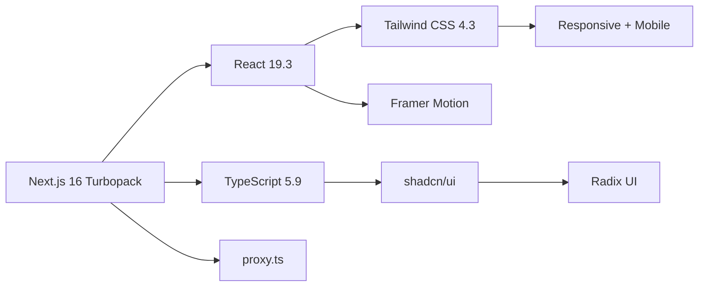
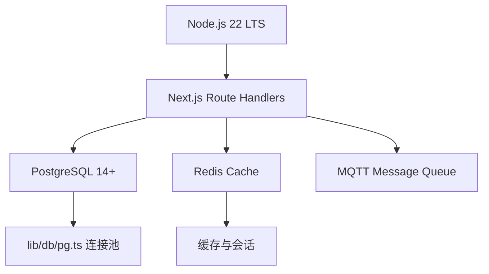

<div align="center">
  
</div>

<h1 align="center">YYC³ Clube System</h1>

<p align="center">
  <strong>言启象限 · 语枢未来 · 深栈智启新纪元</strong><br/>
  <em>Words Initiate Quadrants, Language Serves as Core for the Future</em><br/>
  <em>All things converge in the cloud pivot; Deep stacks ignite a new era of intelligence</em>
</p>

<p align="center">
  <a href="https://nextjs.org/"></a>
  <a href="https://react.dev/"></a>
  <a href="https://www.typescriptlang.org/"></a>
  <a href="https://tailwindcss.com/"></a>
  <a href="https://turbo.build/"></a>
</p>

<p align="center">
  <a href="https://nodejs.org/"></a>
  <a href="https://pnpm.io/"></a>
  <a href="https://www.postgresql.org/"></a>
  <a href="https://redis.io/"></a>
  <a href="https://expo.dev/"></a>
  <a href="https://reactnative.dev/"></a>
</p>

<p align="center">
  
  
  
  
</p>

<p align="center">
  <a href="./LICENSE"></a>
  <a href="./CONTRIBUTING.md"></a>
  <a href="./SECURITY.md"></a>
  <a href="./CODE_OF_CONDUCT.md"></a>
</p>

<p align="center">
  
  
  
  
  
</p>

> **项目状态**：`main` 分支已通过 Next 16 构建、TypeScript 0 错误、standalone 生产运行、艺人报表闭环验收，移动端完成 Expo 58 / RN 0.88 三端构建回归，开源文档套件齐备。
> 验收证据见 [`docs/yyc3-clube-system-trae-20261031/`](./docs/yyc3-clube-system-trae-20261031/)。

---

## 📖 目录

| 章节 | 章节 |
| --- | --- |
| [项目概述](#overview) | [项目结构与工程布局](#structure) |
| [核心技术架构](#architecture) | [项目状态与验证](#status) |
| [技术栈](#tech-stack) | [移动端说明](#mobile) |
| [核心功能模块](#modules) | [开发者文档矩阵](#docs) |
| [快速开始](#quick-start) | [仓库标签与关键词](#keywords) |
| [License](#license) | [联系方式](#contact) |

---

<a id="overview"></a>

## 🎯 项目概述

**YYC³ Clube System** 是为 KTV 商家量身打造的**全栈智能运营平台**，集成 **6 大核心技术模块** + **9 大 AI 智能运营系统**，实现从传统管理到智能决策的全面升级。

### 🚀 核心特性

```
📊 实时数据处理    ⚡ 边缘计算架构    🤖 AI 深度学习    🔗 区块链溯源
📡 5G 高速传输     🌐 物联网集成     📈 大数据分析    🔐 企业级安全
```

### 📈 技术指标

| 指标              | 性能      | 说明                |
| ----------------- | --------- | ------------------- |
| **响应时间**      | < 100ms   | 99% 请求响应时间    |
| **并发处理**      | 10,000+   | 支持同时在线用户    |
| **数据准确率**    | 99.9%     | 实时数据同步准确率  |
| **AI 预测准确率** | 85%+      | 销售/库存预测准确率 |
| **系统可用性**    | 99.95%    | 年度 SLA 保障       |
| **数据安全**      | ISO 27001 | 企业级安全认证      |

---

<a id="architecture"></a>

## 🏗️ 核心技术架构

### 六大核心技术模块

<table>
<tr>
<td width="33%" valign="top">

#### 🤖 AI 深度集成

```yaml
智能推荐引擎: 个性化推荐
智能定价系统: 动态价格优化
AI营销助手: 自动内容生成
智能客服: 24/7 自动问答
预测分析: 销售/库存预测
```

**技术栈**: GPT-4 API, Prophet, LSTM

</td>
<td width="33%" valign="top">

#### 🔗 区块链应用

```yaml
数据溯源: 商品来源追踪
防篡改账本: 财务数据保护
智能合约: 自动化流程
财务审计链: 完整审计追踪
积分系统: 去中心化积分
```

**技术栈**: Ethers.js, Solidity

</td>
<td width="33%" valign="top">

#### ⚡ 边缘计算

```yaml
本地数据处理: 降低延迟 < 50ms
离线模式: 网络中断可用
实时分析: 边缘节点计算
负载均衡: 智能流量分配
缓存策略: 多级缓存架构
```

**技术栈**: Redis, Edge Runtime

</td>
</tr>
<tr>
<td width="33%" valign="top">

#### 📡 5G 应用

```yaml
实时视频监控: 4K 无延迟
AR/VR体验: 虚拟包厢预览
远程协作: 多门店实时协同
高速传输: 大文件秒传
低延迟通信: < 20ms 响应
```

**技术栈**: WebRTC, 5G API

</td>
<td width="33%" valign="top">

#### 🌐 物联网集成

```yaml
智能包厢控制: 灯光/温度/音响
智能库存管理: RFID 自动盘点
能源管理: 能耗监控优化
设备监控: 实时健康检查
传感器网络: 50+ 设备接入
```

**技术栈**: MQTT, RFID, IoT Hub

</td>
<td width="33%" valign="top">

#### 📈 大数据分析

```yaml
实时数据仓库: 秒级查询
商业智能: 多维度分析
预测引擎: 85%+ 准确率
用户行为: 全面用户洞察
数据可视化: 实时图表展示
```

**技术栈**: ClickHouse, ECharts

</td>
</tr>
</table>

---

### 九大 AI 智能运营系统

<details open>
<summary><strong>M7.1 AI 智能经营成本盈亏计算器</strong></summary>

```typescript
核心功能:
  ✓ 自动计算固定成本、变动成本、隐性成本
  ✓ 多维度盈亏分析和预测
  ✓ 多门店、多时间段对比分析
  ✓ 可视化成本结构和盈亏趋势

预期效果:
  📊 成本透明度: 100%
  ⚡ 决策效率: +50%
  💰 利润优化: +15%
```

</details>

<details>
<summary><strong>M7.2 AI 智能客户营销与提档系统</strong></summary>

```typescript
核心功能:
  ✓ 基于 RFM 模型的客户分层
  ✓ 智能客户标签和画像
  ✓ 个性化营销内容自动推送
  ✓ 客户自动提档机制（普通→VIP→忠诚）

预期效果:
  🎯 营销精准度: +80%
  📈 客户响应率: +60%
  💎 营销 ROI: 3倍提升
```

</details>

<details>
<summary><strong>M7.3 AI 智能回访、邀约、短信与呼叫系统</strong></summary>

```typescript
核心功能:
  ✓ 自动生成回访话术和邀约内容
  ✓ 集成短信网关和语音呼叫服务
  ✓ 客户状态跟踪和反馈记录
  ✓ 智能时机推荐

预期效果:
  🚀 回访效率: 10倍提升
  📞 客户触达率: +70%
  💵 人力成本: -60%
```

</details>

<details>
<summary><strong>M7.4 AI 智能经管运维执行跟踪与奖惩系统</strong></summary>

```typescript
核心功能:
  ✓ 自动记录运营任务执行情况
  ✓ 异常识别和优化建议
  ✓ 智能奖惩机制和奖金池分配
  ✓ 绩效评估和趋势分析

预期效果:
  ⚡ 执行效率: +40%
  🎯 异常识别率: 95%+
  🏆 员工积极性: +50%
```

</details>

<details>
<summary><strong>M7.5 AI 智能沟通反馈体系</strong></summary>

```typescript
核心功能:
  ✓ 客户反馈自动分类和情绪识别
  ✓ 满意度评分和优先级判定
  ✓ 内部反馈归档和响应机制
  ✓ 支持匿名反馈和多渠道接入

预期效果:
  ⚡ 反馈处理效率: +70%
  😊 客户满意度: +35%
  ✅ 问题解决率: +50%
```

</details>

<details>
<summary><strong>M7.6 内部沟通体系</strong></summary>

```typescript
核心功能:
  ✓ 支持个人、分组、部门、团队的组织架构
  ✓ 即时通讯和任务协同
  ✓ 消息推送和权限控制
  ✓ 可视化组织图和沟通流转图

预期效果:
  💬 沟通效率: +60%
  🤝 协作效率: +50%
  📋 信息传达准确率: 95%+
```

</details>

<details>
<summary><strong>M7.7 人力资源与绩效管理</strong></summary>

```typescript
核心功能:
  ✓ 员工画像、能力标签、成长路径
  ✓ 绩效评分、晋升建议、离职预测
  ✓ 与奖惩系统联动，形成激励闭环
  ✓ 可视化组织图和人才流动趋势

预期效果:
  😊 员工满意度: +35%
  🎯 人才留存率: +40%
  📊 晋升准确率: 90%+
```

</details>

<details>
<summary><strong>M7.8 战略决策支持系统</strong></summary>

```typescript
核心功能:
  ✓ 汇总所有模块数据，形成战略视图
  ✓ 支持多维度 KPI、ROI、趋势预测
  ✓ 提供"下一步建议"与"风险预警"
  ✓ CEO/管理层专属仪表板

预期效果:
  ⚡ 决策速度: 5倍提升
  🎯 决策准确率: +60%
  ⚠️ 风险识别率: 95%+
```

</details>

<details>
<summary><strong>M7.9 合规与审计自动化</strong></summary>

```typescript
核心功能:
  ✓ 自动记录关键操作与数据变更
  ✓ 生成审计日志与合规报告
  ✓ 与 SYSTEM_AUDIT_REPORT.md 联动
  ✓ 支持安全评分与风险等级标记

预期效果:
  📝 审计效率: 10倍提升
  💰 合规成本: -60%
  🔍 违规检测率: 99%+
```

</details>

---

<a id="tech-stack"></a>

## ⚙️ 技术栈

### 🎨 前端技术



| 技术                | 版本          | 用途                          |
| ------------------- | ------------- | ----------------------------- |
| **Next.js**         | 16.4.3        | App Router、Turbopack、RSC    |
| **React**           | 19.3.1        | 组件化开发、Hooks             |
| **TypeScript**      | 5.9           | 严格模式、类型安全            |
| **Tailwind CSS**    | 4.3           | 原子化 CSS、响应式设计        |
| **Framer Motion**   | Latest        | 页面动效与交互转场            |
| **shadcn/ui**       | Latest        | 高质量组件库（new-york）      |
| **Radix UI**        | Latest        | 无障碍基础组件                |
| **Lucide React**    | 0.562         | 图标系统                      |
| **Zustand**         | 5.x           | 轻量级状态管理                |
| **React Hook Form** | Latest + Zod 4 | 表单处理与 Schema 校验        |

### 🔧 后端技术



| 技术          | 版本          | 用途                         |
| ------------- | ------------- | ---------------------------- |
| **Node.js**   | 22 LTS        | 服务端运行时（最低 20.9）    |
| **PostgreSQL** | 14+          | 主数据库（`lib/db/pg.ts`）   |
| **Redis**     | Latest        | 缓存、会话与限流             |
| **MQTT**      | Latest        | IoT 设备通信                 |
| **Sharp**     | 0.35          | 图片处理                     |
| **Ethers.js** | 6.x           | 区块链扩展                   |
| **Expo / RN** | 58 / 0.88     | 移动端（React Native）       |

### 🤖 AI 与大数据

| 技术           | 用途                     |
| -------------- | ------------------------ |
| **GPT-4 API**  | 智能推荐, 内容生成, 客服 |
| **ClickHouse** | 实时数据仓库, OLAP 分析  |
| **Prophet**    | 时间序列预测             |
| **LSTM**       | 深度学习预测模型         |
| **ECharts**    | 数据可视化               |
| **Recharts**   | React 图表组件           |

### 🧪 测试与质量

```bash
# 单元测试（Jest + Testing Library）
pnpm test:unit
pnpm test:ci
pnpm test:coverage

# E2E 测试（Playwright）
pnpm test:e2e

# 代码质量（提交前必过）
pnpm type-check           # TypeScript 0 错误
pnpm lint                 # ESLint 0 error
pnpm build                # Next 16 + Turbopack，0 warning
```

### 🚀 部署与监控

| 平台/工具            | 用途                                      |
| -------------------- | ----------------------------------------- |
| **Standalone**       | `node .next/standalone/server.js`         |
| **Vercel Analytics** | 性能监控与访问分析                        |
| **GitHub Actions**   | CI/CD（类型、Lint、构建、测试）           |
| **Lighthouse**       | 性能与无障碍回归（目标 ≥ 90）             |
| **pnpm audit**       | 依赖安全门禁（当前 0 critical / 1 high）  |

---

<a id="modules"></a>

## 📦 核心功能模块

### 💼 1. 销售管理

```typescript
功能覆盖:
  📋 订单列表      → 多维度筛选, 数据导出
  💰 账单列表      → 状态跟踪, 详情查看
  📅 在线预定      → 预定管理, 状态监控
  📊 销售报表      → 实时统计, 趋势分析
  🎯 绩效分析      → 员工业绩, KPI 追踪
```

### 🛍️ 2. 商品管理

```typescript
功能覆盖:
  📦 商品列表      → 资料管理, 类型分类, 口味设置
  🎁 商品套餐      → 套餐配置, 价格策略, 组合优化
  🏠 开房套餐      → 时间/酒水/低消/团购套餐
  ⏱️ 计时开房      → 计时单价, 包断金额, 低消设置
  🚚 商品配送      → 固定配送, 手工配送规则
  💎 价格策略      → 区域差异化定价, 动态调价
  🎖️ 积分兑换      → 会员积分, 兑换规则
```

### 📦 3. 仓库管理

```typescript
功能覆盖:
  🏢 仓库列表      → 多仓管理, 出货仓配置
  📥 采购进货      → 供应商管理, 成本核算
  🔄 库存调拨      → 门店/仓库间调拨
  📊 库存盘点      → 实时盘点, 盈亏统计
  📈 实时库存      → 库存查询, 预警设置
  🍷 寄存管理      → 酒水寄存, 到期提醒
  🤖 RFID 自动盘点 → IoT 智能库存管理
```

### 📊 4. 报表分析

```typescript
功能覆盖:
  📈 实时数据仪表板  → 核心 KPI 实时展示
  💹 销售趋势分析    → 多维度趋势预测
  👥 客户行为分析    → RFM 模型, 用户画像
  💰 财务利润分析    → 成本核算, 盈亏预测
  📊 库存周转分析    → 周转率, 呆滞预警
  🎯 员工绩效分析    → 绩效评估, 激励建议
```

### 👥 5. 员工管理

```typescript
功能覆盖:
  👤 员工档案      → 基础信息, 能力标签
  🎯 绩效考核      → 多维度评分, 晋升建议
  💰 薪资管理      → 工资核算, 奖金分配
  📅 排班管理      → 智能排班, 考勤统计
  🎓 培训体系      → 培训计划, 成长路径
  🏆 激励系统      → 奖惩记录, 积分体系
```

### 🌐 6. 物联网集成

```typescript
功能覆盖:
  💡 智能包厢控制   → 灯光/温度/音响自动化
  📡 设备监控中心   → 实时状态, 故障预警
  🔋 能源管理       → 能耗监控, 节能优化
  📦 RFID 库存      → 自动盘点, 实时追踪
  🌡️ 环境传感器     → 温湿度, 空气质量
  🔐 智能门禁       → 人脸识别, 权限控制
```

---

<a id="quick-start"></a>

## 🚀 快速开始

### 📋 环境要求

```bash
Node.js     ≥ 20.9（推荐 22 LTS）
pnpm        ≥ 10（推荐 12）
PostgreSQL  ≥ 14
Redis       ≥ 6（可选，用于缓存/会话）
Expo        SDK 58（移动端，可选）
```

### 📥 安装步骤

```bash
# 1. 克隆项目
git clone https://github.com/YYC-Cube/YYC3-Clube-Management-System.git
cd YYC3-Clube-Management-System

# 2. 安装依赖（单一 pnpm-lock.yaml）
pnpm install

# 3. 配置环境变量
cp .env.example .env.local
# 编辑 .env.local：DATABASE_URL / PG_* / JWT_SECRET 等

# 4. 初始化数据库（艺人域）
psql "$DATABASE_URL" -f scripts/migrations/20261031_artist_domain.pg.sql

# 5. 启动开发服务器（端口 3030）
pnpm dev
```

### 🏗️ 生产构建

```bash
pnpm build          # Next 16 + Turbopack + standalone 静态资源准备
PORT=3030 pnpm start  # node .next/standalone/server.js
```

### 📱 移动端（Expo SDK 58）

```bash
pnpm --filter ktv-admin-mobile start
pnpm --filter ktv-admin-mobile exec expo export --platform all
```

移动端通过 `EXPO_PUBLIC_API_BASE_URL` 指向 Web API，默认 `http://localhost:3030`。

### 🌐 访问应用

```
开发环境: http://localhost:3030
生产环境: https://clube.yyc3.top
```

### 🧪 运行测试

```bash
pnpm test:unit          # 单元测试
pnpm test:ci            # CI 模式
pnpm test:e2e           # Playwright E2E
pnpm test:coverage      # 覆盖率报告
pnpm --filter ktv-admin-mobile exec tsc --noEmit  # 移动端类型检查
```

---

<a id="structure"></a>

## 📂 项目结构

```
YYC3-Clube-Management-System/
├── app/                          # Next.js 16 App Router
│   ├── api/                      # Route Handlers（动态 params 异步化）
│   ├── dashboard/                # 管理后台页面
│   │   ├── reports/              # 报表中心（含 artist 艺人报表）
│   │   ├── ai-ops/               # AI 运营系统
│   │   ├── bigdata/              # 大数据分析
│   │   ├── iot/                  # 物联网控制
│   │   ├── edge/                 # 边缘计算
│   │   ├── 5g/                   # 5G 应用
│   │   └── ai/                   # AI 应用
│   └── layout.tsx                # 根布局（metadata + viewport）
├── proxy.ts                      # Next 16 请求代理（原 middleware）
├── components/                   # React 组件
│   ├── ui/                       # shadcn/ui 基础组件
│   ├── dashboard/                # DataTable / FilterBar / StatCard
│   ├── reports/artist/           # 艺人报表导航与页头
│   ├── layout/                   # Sidebar / Header
│   ├── forms/                    # 会员 / 商品表单
│   └── ai-ops/ bigdata/ iot/ edge/ 5g/ ai/
├── lib/                          # 领域服务与工具
│   ├── db/                       # PostgreSQL 连接池与仓储
│   ├── services/                 # 报表、导出、支付等服务
│   ├── validations/              # Zod Schema
│   └── types/                    # 领域类型
├── hooks/                        # 自定义 Hooks
├── mobile-app/                   # Expo 58 + React Native 0.88
│   ├── index.js                  # registerRootComponent 入口
│   ├── app.json                  # Expo 配置
│   └── src/screens + services
├── scripts/
│   ├── migrations/               # 艺人域 SQL 迁移
│   └── prepare-standalone.mjs    # standalone 资源复制
├── docs/
│   ├── design/                   # 可视化交互体系设计
│   ├── YYC3-团队通用-标规文档/    # 团队标准（SSOT）
│   └── yyc3-clube-system-trae-20261031/  # 审计与交接
├── contracts/                    # 智能合约扩展
├── __tests__/                    # Jest 测试
├── public/                       # 静态资源（含 yyc3-family.png）
└── .env.example                  # 环境变量模板
```

---

<a id="status"></a>

## 📊 项目状态与验证

| 验证项 | 结果 |
| --- | --- |
| Web 类型检查 | ✅ `pnpm type-check` 0 错误 |
| Web 生产构建 | ✅ Next 16 + Turbopack，154/154 页面，0 warning |
| 生产运行 | ✅ `node .next/standalone/server.js`，页面/JS/CSS/API 均 200 |
| 艺人报表单测 | ✅ 50/50（7 suites：艺人域 39、分页 6、DataTable 组件 5）+ 6/6 临时 PostgreSQL 集成；全项目 55 suites / 503 tests |
| 报表前端分页 | ✅ 4 张报表页 20 条/页；Playwright 实测 22 条 → 2 页切换与禁用态正确，0 error |
| 万级压测 | ✅ 10000 上下钟 + 5000 扣款：6 端点 P95 12.8–73.5ms（阈值 500ms），0 错误 |
| 移动端类型检查 | ✅ Expo 58 + TS 6，0 错误 |
| 移动端 Bundle | ✅ `expo export --platform all`（Web / Android / iOS） |
| 依赖安全 | ✅ 0 critical；1 high（`ip`，React Native CLI 开发工具，暂无上游补丁） |
| 数据库 | ✅ 艺人域 PG 建表脚本（6 表）在临时 PostgreSQL 集群执行 2 次通过 |
| 艺人报表 API | ✅ 4 个接口实测 200（`source=db`）；断库自动回退 `mock`；非法参数 400 |
| 报表导出 | ✅ 服务端 CSV 导出 10000 行 200（BOM + `X-Export-Row-Count`）；超 5 万行 400；审计落库 |

> 完整证据链：[`docs/yyc3-clube-system-trae-20261031/04-测试验证方案与报告.md`](./docs/yyc3-clube-system-trae-20261031/04-测试验证方案与报告.md)

### 艺人域数据接口

| 方法 | 路径 | 说明 |
| --- | --- | --- |
| GET | `/api/reports/artist/clock-detail` | 上下钟明细（分页 + 指标） |
| GET | `/api/reports/artist/clock-summary` | 上下钟汇总（按艺人聚合） |
| GET | `/api/reports/artist/fee-deduction` | 台费扣款明细（分页 + 指标） |
| GET | `/api/reports/artist/fee-summary` | 台费流水汇总（已结/待结/进度） |
| POST | `/api/reports/artist/export` | 服务端 CSV 导出（4 类报表、5 万行上限、审计落库、操作人可信标记） |

- 通用参数：`from`、`to`（`YYYY-MM-DD`，`Asia/Shanghai`）、`store`、`artistId`、`status`、`type`、`search`、`page`、`pageSize`（≤200）。
- 响应：`{ success, data: { data, pagination, metrics, source } }`，响应头 `X-Artist-Data-Source: db | mock`。
- 导出：`POST` 请求体 `{ reportType, filter }`，返回 `text/csv`（UTF-8 BOM），响应头 `X-Export-Row-Count` / `X-Operator-Trust`（`jwt | header | none`）；超过 50000 行返回 400；成功/失败均可在 `artist_report_export_audit` 追溯。登录后导出自动携带 `Authorization: Bearer`，审计标记 `trust=jwt`。
- 数据源：`ARTIST_REPORT_DATA_SOURCE=auto`（默认，异常回退 Mock）/ `db`（强制真实库）/ `mock`（纯演示）。
- 压测：`scripts/seeds/artist-report-bench.sql` 生成万级数据，`scripts/loadtest/artist-report-bench.mjs` 输出 P50/P95/P99。
- 仓储层：[`lib/db/repositories/artist-report-repository.ts`](./lib/db/repositories/artist-report-repository.ts)；接口契约见 [`05-艺人报表数据模型与接口建议.md`](./docs/yyc3-clube-system-trae-20261031/05-艺人报表数据模型与接口建议.md)。

---

<a id="mobile"></a>

## 📱 移动端说明

- 技术栈：**Expo SDK 58 / React Native 0.88 / React 19.3 / TypeScript 6**。
- 入口：`mobile-app/index.js` → `src/App.tsx`，React Navigation 7 管理登录、仪表盘与订单页。
- API：通过 `EXPO_PUBLIC_API_BASE_URL` 连接 Web 端 Route Handlers，默认 `http://localhost:3030`。
- 回归：`pnpm --filter ktv-admin-mobile exec tsc --noEmit` 与 `expo export --platform all` 均通过。
- 说明：原生 IPA/APK 构建需要 Xcode / Android SDK；本仓库验证的是三端 JS Bundle 与类型完整性。

---

<a id="docs"></a>

## 📚 开发者文档矩阵

| 文档 | 说明 |
| --- | --- |
| [README.md](./README.md) | 项目自述、架构、快速开始与状态 |
| [LICENSE](./LICENSE) | MIT 开源许可证 |
| [CODE_OF_CONDUCT.md](./CODE_OF_CONDUCT.md) | Contributor Covenant v2.1 行为准则 |
| [CONTRIBUTING.md](./CONTRIBUTING.md) | 分支、提交、质量门禁与 PR 流程 |
| [SECURITY.md](./SECURITY.md) | 漏洞报告、支持版本、安全基线与历史修复 |
| [docs/README.md](./docs/README.md) | 文档中心与模块导航 |
| [docs/design/YYC3-VISUAL-INTERACTION-SYSTEM.md](./docs/design/YYC3-VISUAL-INTERACTION-SYSTEM.md) | 可视化交互体系设计（令牌/组件/动效/报表/多端） |
| [docs/YYC3-团队通用-标规文档/](./docs/YYC3-团队通用-标规文档/) | 团队五高五标五化五维 SSOT |
| [docs/yyc3-clube-system-trae-20261031/](./docs/yyc3-clube-system-trae-20261031/) | 首次全维度审核、测试、交接与艺人域数据模型 |

### 视觉与交互

- 视觉资产：`public/yyc3-family.png`（YYC³ Family 品牌顶图）。
- 设计令牌：`app/globals.css`（OKLCH 主题色、暗色模式、图表色、圆角）。
- 组件体系：shadcn/ui（new-york） + Radix UI，统一 `DataTable`、`FilterBar`、`StatCard`、`ChartContainer`。
- 设计原则：五维驱动 · 五高架构 · 五标体系 · 五化转型。

---

<a id="keywords"></a>

## 🏷️ 仓库标签与关键词

**GitHub Topics（建议在仓库 Settings → Topics 配置）**

`ktv` · `club-management` · `ktv-management` · `nextjs` · `nextjs16` · `react` · `react19` · `typescript` · `tailwindcss` · `shadcn-ui` · `radix-ui` · `ai-operations` · `artist-management` · `reporting` · `data-visualization` · `iot` · `mqtt` · `edge-computing` · `bigdata` · `postgresql` · `expo` · `react-native` · `open-source`

**package.json keywords（npm / 包发现）**

```json
["yyc3", "ktv", "club-management", "nextjs", "react", "typescript", "tailwindcss", "shadcn-ui", "radix-ui", "ai-operations", "artist-management", "reports", "iot", "open-source"]
```

**仓库简介（GitHub About，建议 ≤ 350 字符）**

> YYC³ Clube System —— KTV / 夜场全栈智能运营平台。Next.js 16 + React 19 + shadcn/ui + PostgreSQL + Redis + MQTT，内置 9 大 AI 运营系统与艺人上下钟 / 台费报表闭环。言启象限，语枢未来。

**检索关键词（中文）**

KTV 管理系统 · 夜场管理系统 · 艺人管理 · 上下钟报表 · 台费结算 · 智能运营 · AI 运营 · 边缘计算 · 物联网 · 5G 应用 · 大数据分析 · 区块链溯源 · 开源管理系统

**标签规范**

| 标签形态 | 示例 | 用途 |
| --- | --- | --- |
| `v{major}.{minor}.{patch}` | `v0.1.0` | 正式发布 |
| `v{major}.{minor}.{patch}-rc.{n}` | `v0.2.0-rc.1` | 候选发布 |
| `docs/{scope}` | `docs/artist-reports` | 文档里程碑 |
| `audit/{yyyy-mm}` | `audit/2026-10` | 审核基线 |

> 标签与关键词须与 `package.json#keywords`、[`docs/README.md`](./docs/README.md) 索引保持一致，新增模块时同步更新本节。

---

<a id="license"></a>

## 📄 License

本项目采用 **MIT License** 开源协议，详见 [LICENSE](./LICENSE)。

- 安全策略：[SECURITY.md](./SECURITY.md)
- 贡献指南：[CONTRIBUTING.md](./CONTRIBUTING.md)
- 行为准则：[CODE_OF_CONDUCT.md](./CODE_OF_CONDUCT.md)
- 安全联系：`admin@0379.email`

---

<a id="contact"></a>

## 👨‍💻 联系方式

<p align="center">
  <a href="mailto:admin@0379.email">
    
  </a>
  <a href="https://github.com/YYC-Cube/YYC3-Clube-Management-System">
    
  </a>
  
</p>

---

<div align="center">
  <strong>YYC³ Clube System</strong><br/>
  Made with ❤️ by YYC-Cube Team<br/>
  © 2026 YYC-Cube. All rights reserved.
</div>
