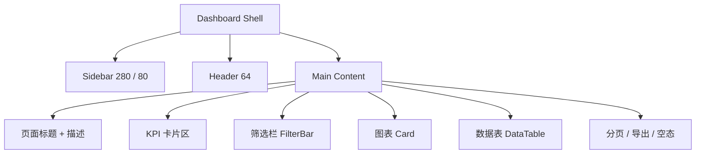
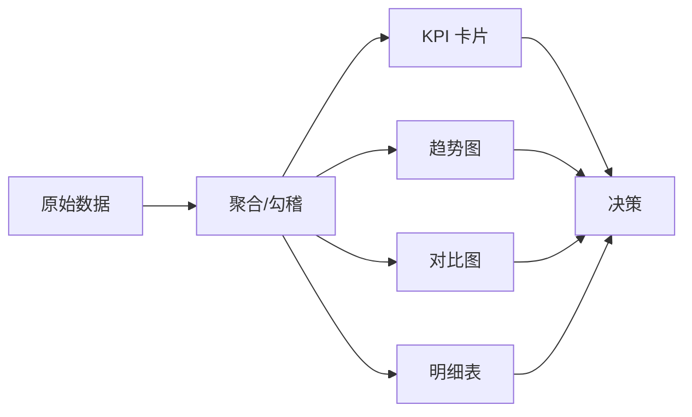

> **_YanYuCloudCube_**
> _言启象限 | 语枢未来_
> **_Words Initiate Quadrants, Language Serves as Core for Future_**
> _万象归元于云枢 | 深栈智启新纪元_
> **_All things converge in cloud pivot; Deep stacks ignite a new era of intelligence_**

# 🎨 YYC³ Clube System 可视化交互体系

> **可视 · 可解 · 可演 · 可度量**

---

## 一、设计定位

本设计体系服务于 YYC³ Clube System 的 Web 管理后台与 Expo 移动端，目标是把「五维驱动 · 五高五标五化」转译为可落地的视觉与交互规则：

| 维度 | 设计转译 |
| --- | --- |
| **时间维** | 动效短、可中断、可降级；报表日期筛选即时反馈 |
| **空间维** | 侧边栏 + 内容区 + 卡片网格；信息密度分层 |
| **属性维** | 颜色/字号/圆角/阴影全部令牌化；暗色模式一致 |
| **事件维** | 加载、空态、错误、成功、危险操作五态齐全 |
| **关联维** | 报表 → 明细 → 结算 → 导出形成可追溯链路 |

### 1.1 设计原则

1. **信息优先**：先看清数据，再谈装饰；报表以可读性为第一目标。
2. **一致可预期**：同类操作使用同一组件、同一位置、同一反馈。
3. **渐进披露**：总览 → 筛选 → 明细 → 导出，逐层展开。
4. **可访问**：键盘可达、焦点可见、对比度达标、动效可关闭。
5. **可度量**：每个交互都能对应验收标准与可观测指标。

---

## 二、视觉识别

### 2.1 品牌资产

| 资产 | 路径 | 用途 |
| --- | --- | --- |
| YYC³ Family 顶图 | `public/yyc3-family.png`（1800×450） | README / 文档页头 |
| 品牌标语 | 言启象限 · 语枢未来 · 万象归元 · 深栈智启 | 页脚、文档头 |
| 产品名 | YYC³ Clube System | 标题、导航、页脚 |
| 技术标识 | Next 16 / React 19 / Turbopack / PostgreSQL | 徽章与架构图 |

### 2.2 色彩令牌（OKLCH）

来源：`app/globals.css`。亮色与暗色共用同一语义令牌，业务代码禁止硬编码颜色。

| 语义 | 亮色 | 暗色 | 用途 |
| --- | --- | --- | --- |
| `--background` | `oklch(0.99 0 0)` | `oklch(0.15 0 0)` | 页面底色 |
| `--foreground` | `oklch(0.15 0 0)` | `oklch(0.98 0 0)` | 主文本 |
| `--card` | `oklch(1 0 0)` | `oklch(0.18 0 0)` | 卡片 |
| `--primary` | `oklch(0.55 0.18 265)` | `oklch(0.65 0.2 265)` | 主行动/品牌蓝紫 |
| `--secondary` | `oklch(0.96 0.01 265)` | `oklch(0.25 0.01 265)` | 次级按钮/标签 |
| `--muted` | `oklch(0.97 0.005 265)` | `oklch(0.25 0.01 265)` | 弱化背景 |
| `--destructive` | `oklch(0.577 0.245 27.325)` | `oklch(0.5 0.2 27)` | 危险/扣款/亏损 |
| `--border` | `oklch(0.92 0.005 265)` | `oklch(0.25 0.01 265)` | 边框/分隔 |
| `--ring` | `oklch(0.55 0.18 265)` | `oklch(0.65 0.2 265)` | 焦点环 |

### 2.3 图表色

| 令牌 | 用途 |
| --- | --- |
| `--chart-1` | 主序列：台费、上钟次数 |
| `--chart-2` | 次序列：实收、结算 |
| `--chart-3` | 对比序列：扣款、风险 |
| `--chart-4` / `--chart-5` | 分类/辅助序列 |

> 图表通过 `ChartContainer config` 注入 `--color-{key}`，禁止直接写死十六进制色值。

### 2.4 字体与排版

| 层级 | 字体 | 字号/字重 | 用途 |
| --- | --- | --- | --- |
| Display | Geist Sans | 30/36px · 700 | 页面标题 |
| Heading | Geist Sans | 16–20px · 600 | 卡片标题 |
| Body | Geist Sans | 14px · 400 | 正文/表格 |
| Caption | Geist Sans | 12px · 400 | 辅助说明 |
| Mono | Geist Mono | 12px · 400 | 订单号/上钟单号 |

- 数字金额使用等宽或表格数字特性，右对齐。
- 中英文混排保持 1.5–1.7 行高。
- 标题不超过两行，超长使用省略并提供 Tooltip。

### 2.5 间距、圆角与阴影

- 间距基数为 **4px**：`4 / 8 / 12 / 16 / 24 / 32`。
- 圆角令牌：`--radius = 0.75rem`，`sm/md/lg/xl` 派生。
- 卡片阴影：轻量 `shadow-sm`；浮层使用 Popover/Dialog 自带阴影。
- 内容容器：`container mx-auto p-6 md:p-8`。

---

## 三、布局与信息架构

- 侧边栏可折叠：展开 280px，收起 80px；当前路由高亮。
- Header 提供全局搜索、通知、主题切换。
- 内容区统一 `space-y-6`，卡片网格 `gap-4/6`。
- 报表页顺序固定：**标题 → 报表导航 → KPI → 筛选 → 图表 → 表格**。

---

## 四、组件体系

### 4.1 基础组件（shadcn/ui + Radix）

| 类别 | 组件 | 交互要求 |
| --- | --- | --- |
| 行动 | Button | 主/次/危险/幽灵；加载态禁用；键盘 Enter/Space |
| 输入 | Input / Textarea / Select | Label 关联；错误文案；受控/非受控一致 |
| 反馈 | Toast / Alert / Dialog | 成功/失败/危险；焦点捕获与 Esc 关闭 |
| 导航 | Sidebar / Tabs / Breadcrumb | 当前态清晰；键盘可切换 |
| 数据 | Table / Badge / Progress | 空态、加载态、状态色语义化 |

### 4.2 业务组件

| 组件 | 文件 | 职责 |
| --- | --- | --- |
| `StatCard` | `components/dashboard/stat-card.tsx` | KPI 数值 + 趋势 + 说明 |
| `FilterBar` | `components/dashboard/filter-bar.tsx` | 搜索/筛选/日期/导出/新增 |
| `DataTable` | `components/dashboard/data-table.tsx` | 表格、加载/空态、行点击、操作列 |
| `ChartContainer` | `components/ui/chart.tsx` | 图表主题、Tooltip、响应式 |
| `ArtistReportNav` | `components/reports/artist/artist-report-nav.tsx` | 5 个艺人报表切换 |
| `ArtistReportHeader` | `components/reports/artist/artist-report-header.tsx` | 报表页统一页头 |

### 4.3 组件契约

- `FilterBar.filters[]` 支持 `value` 受控筛选；`searchValue`/`onSearchChange` 受控搜索。
- `DataTable` 支持 `loading`、`onRowClick`、`actions`；列定义使用 `render(value, row)`。
- 组件不得在 Server → Client 边界传递函数/类实例/图标组件。
- 所有组件必须有默认态、悬停态、聚焦态、禁用态。

---

## 五、动效与交互

### 5.1 动效规范（Framer Motion）

| 场景 | 时长 | 缓动 | 说明 |
| --- | --- | --- | --- |
| 页面进入 | 300ms | easeInOut | `opacity + y: 20 → 0` |
| 卡片进入 | 400ms | ease | 延迟 0 / 0.1 / 0.2 / 0.3 |
| 表格行 | 300ms | ease | 逐行 50ms 阶梯 |
| 侧边栏折叠 | 300ms | easeInOut | 宽度/透明度 |
| 危险操作 | 150ms | ease | 仅颜色/边框变化 |

- 支持 `prefers-reduced-motion`：关闭位移与缩放，仅保留透明度。
- 动效不得阻塞输入；异步操作必须有加载态。

### 5.2 五态设计

| 状态 | 表现 |
| --- | --- |
| Loading | 表格显示「加载中…」；按钮禁用并显示 Spinner |
| Empty | 表格「暂无数据」；图表给引导文案 |
| Error | Toast/Alert + 可重试；不暴露内部堆栈 |
| Success | Toast 成功；列表刷新；保持筛选条件 |
| Danger | 二次确认 Dialog；危险按钮使用 destructive |

### 5.3 键盘与焦点

- Tab 顺序遵循视觉顺序；Dialog 打开后焦点进入并循环。
- 所有图标按钮必须有 `aria-label`。
- 焦点环使用 `--ring`，不得移除 outline 而不提供替代。
- 表格行点击需同时提供键盘可达的操作入口。

---

## 六、数据可视化规范

### 6.1 图表选择

| 目标 | 图表 | 示例 |
| --- | --- | --- |
| 排名/对比 | 柱状图 | 艺人上钟次数排行 |
| 时间趋势 | 折线图 | 台费/扣款趋势 |
| 构成 | 堆叠柱/环形（≤5 类） | 扣款类型构成 |
| 多维对比 | 分组柱 | 台费/扣款/应结 |
| 单值 | KPI 卡 | 应结台费、结算率 |

### 6.2 数据表达

- 金额统一 `¥1,234.56`；比率保留 1 位小数。
- 时长统一 `x小时y分` 或 `xh`，同一页面保持一致。
- 负值/扣款使用 `text-destructive`，并保留负号。
- 图表 Tooltip 必须显示单位与时间范围。
- 无数据时展示空态，不渲染空白坐标轴。

### 6.3 报表交互范式

| 步骤 | 组件 | 规则 |
| --- | --- | --- |
| 1. 范围 | `FilterBar` + DateRange | 默认最近 7 天；闭区间 |
| 2. 维度 | 门店/艺人/类型/状态 | 支持组合筛选；即时生效 |
| 3. 总览 | KPI 卡片 | 与表格同口径 |
| 4. 分析 | 图表 | 最多 8 个类别，避免拥挤 |
| 5. 明细 | `DataTable` | 支持导出、行点击 |
| 6. 导出 | CSV + BOM | 文件名含报表名与日期 |

**艺人报表映射**：

| 报表 | KPI | 图表 | 表格 |
| --- | --- | --- | --- |
| 上下钟明细 | 次数/时长/台费/实收 | — | 逐单 |
| 上下钟汇总 | 同上 | 上钟次数排行 | 按艺人 |
| 台费扣款明细 | 有效笔数/金额/人数/均值 | — | 逐笔 |
| 台费流水汇总 | 台费/扣款/应结/结算率 | 台费/扣款/应结对别 | 按艺人 |

---

## 七、多端适配

| 端 | 断点/形态 | 规则 |
| --- | --- | --- |
| Desktop | ≥1280px | 侧边栏展开；4 列 KPI；表格全列 |
| Laptop | 1024–1279px | 侧边栏可折叠；2–4 列 KPI |
| Tablet | 768–1023px | 2 列 KPI；表格横向滚动 |
| Mobile Web | <768px | 单列卡片；筛选换行；表格横向滚动 |
| Expo App | iOS/Android | 触控目标 ≥44px；原生导航栈；API 基址可配置 |

- 移动端与 Web 共享语义色与文案，不共享具体布局。
- 移动端禁止依赖 `localStorage`；Token 使用安全存储方案（后续接入 AsyncStorage/Keychain）。
- 深色模式跟随系统，同时提供手动切换。

---

## 八、无障碍与国际化

- 目标：**WCAG 2.2 AA**。
- 文本对比度 ≥ 4.5:1；大字号 ≥ 3:1。
- 表单错误使用文字 + 颜色双重提示。
- 图标不单独承载信息，必须有文本或 aria-label。
- 语言：`zh-CN`；日期 `yyyy年MM月dd日`；金额人民币。
- 数字/日期格式集中封装，禁止页面内散落格式化逻辑。

---

## 九、落地映射

| 设计项 | 代码位置 |
| --- | --- |
| 颜色/圆角/图表色 | `app/globals.css` |
| Tailwind 主题映射 | `app/globals.css` 的 `@theme inline` |
| 基础组件 | `components/ui/*` |
| 业务组件 | `components/dashboard/*`、`components/reports/artist/*` |
| 页面骨架 | `app/dashboard/layout.tsx` |
| 移动端 | `mobile-app/src/App.tsx`、`mobile-app/src/screens/*` |
| 报表数据口径 | `lib/services/artist-report.ts` |

---

## 十、验收清单

- [ ] 颜色/字体/圆角全部来自令牌，无新增硬编码色值
- [ ] 亮色/暗色模式视觉一致，文本对比度达标
- [ ] 页面加载/空态/错误/成功/危险五态齐全
- [ ] 所有交互键盘可达，焦点可见，图标有 aria-label
- [ ] 表格/图表在 375px 宽度可横向滚动且不截断
- [ ] 报表 KPI、图表、表格口径一致且可勾稽
- [ ] 动效 ≤400ms，支持 reduced motion
- [ ] 移动端三端 Bundle 通过，触控目标 ≥44px
- [ ] 设计变更同步更新本文件与 README

---

## 十一、版本记录

| 版本 | 日期 | 变更 |
| --- | --- | --- |
| v1.0.0 | 2026-10-31 | 初始视觉交互体系：令牌、组件、动效、报表、多端、无障碍 |

---

> ***YanYuCloudCube***
> *言启象限 | 语枢未来*
> *万象归元于云枢 | 深栈智启新纪元*
>
> **© 2025-2026 YanYuCloudCube™. All Rights Reserved.**
